# Customer Care Voice Agent

## Proposed architecture and build plan

|                  |                 |
| ---------------- | --------------- |
| **Prepared for** | [Client name]   |
| **Prepared by**  | [Your name]     |
| **Updated**      | 16 October 2026 |

We will build an outbound voice agent that calls your customers from an Indian number, speaks Hindi and English, understands Hinglish, and follows the conversation rules you approve. It will connect to your business systems, confirm proposed actions with the customer, and return a structured result for your team to review.

**Planned stack: Plivo for phone calls, Pipecat for the live conversation, and a TypeScript application for integration, business rules and the dashboard.** We will implement the AI approach the client selects from the quotation.

This brief defines the proposed system, how its components will work together, and the stages we will follow to build and validate it.

## 1. Architecture we will build

We will separate the live audio conversation from the application that manages requests, business rules and call records. Your business systems will remain the source of truth for orders and customer details.

**Reading the diagram:** HTTPS will carry requests and results. WSS will carry live call audio over a secure, two-way WebSocket connection. Pipecat will connect the selected AI model to the live conversation. The dashboard will retrieve records through the authenticated API.

| Component                      | Responsibility                                                                                                                                  | Boundary                                                                           |
| ------------------------------ | ----------------------------------------------------------------------------------------------------------------------------------------------- | ---------------------------------------------------------------------------------- |
| **Your business system**       | Decides when to request a call and supplies customer details, the use case and permitted actions. Applies confirmed changes to its own records. | Owns order and customer data.                                                      |
| **TypeScript API**             | Validates requests, schedules attempts, starts Plivo calls, enforces action limits and delivers results.                                        | Owns application rules and call lifecycle records.                                 |
| **Plivo**                      | Connects the customer’s phone, streams audio and reports call status.                                                                           | Provides telephony; does not decide business actions.                              |
| **Pipecat service**            | Runs the live conversation, routes audio, manages turns and interruptions, and requests approved actions through the API.                       | Owns the active conversation session; does not bypass business rules.              |
| **AI model**                   | Process the conversation using the approach selected from the quotation.                                                                        | Receive the context required for the conversation; have no direct database access. |
| **Call records and dashboard** | Store and display attempts, transcripts, outcomes, confirmed changes and delivery status.                                                       | Access is restricted to authorised team members.                                   |

We will build the TypeScript backend as a modular application, with clear modules for call management, integrations, action validation and reporting. A separate Python service will run Pipecat’s live voice pipeline. This separation will let us tune audio processing independently while keeping business rules in one place. The first deployment will place both services on a single client-owned VPS.

## 2. How a call will run

1. **Receive the request.** Your system will send a unique request ID, customer details, the selected use case and the limits the agent must respect.
2. **Validate and schedule.** The API will check authentication, required fields, duplicate requests, calling hours and retry eligibility before starting an attempt.
3. **Dial through Plivo.** The API will ask Plivo to call the customer. When the call connects, Plivo will open the configured bidirectional audio stream to Pipecat. Provider callbacks will report unanswered, failed and completed attempts.
4. **Run the conversation.** Pipecat will use the selected AI model to understand the customer and generate replies. When the customer interrupts, the conversation engine will stop the current reply and clear queued playback before continuing.
5. **Confirm proposed changes.** The agent will repeat the proposed change or offer and ask for confirmation. The API will independently check the allowed action and its limits.
6. **Save and deliver the result.** The application will store the attempt, transcript and outcome, then send the result to your system. The dashboard will show whether that result was acknowledged or still needs delivery.

Plivo supports bidirectional audio streams, and Pipecat provides a serializer for its streaming protocol. The integration must configure the matching audio format, secure stream access and interruption handling. See the official [Plivo streaming guide](https://www.plivo.com/docs/voice-agents/audio-streaming/concepts/audio-streaming-guide) and [Pipecat Plivo serializer reference](https://docs.pipecat.ai/api-reference/server/services/serializers/plivo).

### Live conversation flow

Plivo will stream customer audio to Pipecat. Pipecat will exchange audio or text with the selected AI model, manage conversation turns and interruptions, and return reply audio through Plivo.

## 3. AI model integration

The client will choose one AI approach from the quotation. We will implement that selected approach for this project. The choice will determine how listening, reasoning and speech generation are connected within the Pipecat session.

The AI model will handle the conversation; the application API will enforce business rules and validate requested actions. We will confirm the selected approach’s API access, configuration and Pipecat integration, then test its Hindi, English and Hinglish conversations, interruptions and action handling before go-live.

## 4. Business integration and action control

We will connect your system through two message flows: a request to start a call, and a result delivered after each attempt. Your system will apply confirmed changes to its own records. The agent will report an update as applied only when the integration confirms that it has succeeded.

| Message          | Contents                                                                                                                                                | Handling                                                                                     |
| ---------------- | ------------------------------------------------------------------------------------------------------------------------------------------------------- | -------------------------------------------------------------------------------------------- |
| **Call request** | Unique request ID, customer reference and phone number, use case, relevant order details, allowed changes and limits.                                   | Authenticate, validate, persist and acknowledge before scheduling the call.                  |
| **Call result**  | Request and attempt IDs, outcome, proposed or confirmed changes, confirmation status, duration, transcript reference and failure details when relevant. | Sign the message, record delivery status and retry failed delivery within configured limits. |

We will define a conversation plan for what the agent may discuss and backend validation for what it may approve. Customer speech and AI-generated tool requests will be treated as untrusted input; neither will be allowed to override the configured limits.

The sequence records the customer’s decision; the final webhook acknowledgment confirms receipt, not necessarily that an order update has been applied. If a use case requires an immediate business update during the call, its action API and success response must be agreed before enabling it.

The architecture will accommodate conversation plans such as order confirmation, cancellation handling, permitted detail changes and discount negotiation within a maximum limit. We will define the selected use case’s inputs, confirmation steps, allowed actions and outcomes before building its conversation flow. Requests outside that plan will be recorded for team follow-up.

## 5. Reliability, security and visibility

| Area                            | Planned behavior                                                                                                                                                                                                   |
| ------------------------------- | ------------------------------------------------------------------------------------------------------------------------------------------------------------------------------------------------------------------ |
| **Repeated requests**           | Persist request and attempt identifiers so replayed integration messages do not create additional attempts. If a dial request times out with an uncertain provider result, reconcile its status before redialling. |
| **Retries**                     | Keep unanswered-call retries separate from result-delivery retries. Both use bounded attempts, backoff and recorded status; call retries also respect the approved calling window.                                 |
| **Model or audio failure**      | Apply timeouts, stop unsafe or incomplete actions and record an incomplete or failed outcome. Keep the selected AI model configuration fixed during an active call.                                                |
| **Business system unavailable** | Retain the result for later delivery. Exhausted delivery attempts remain visible for manual recovery; they do not trigger a fresh customer call.                                                                   |
| **Authorisation**               | Authenticate business requests and internal service traffic, verify Plivo callbacks, and bind each audio stream to its expected call session. Keep call-result destinations in approved configuration.             |
| **Action safety**               | Validate allowed fields and discount limits in application code. Preserve the confirmation and validation outcome for review; an LLM response alone cannot authorise a change.                                     |
| **Sensitive information**       | Keep credentials on the server in validated configuration. Restrict transcript access, redact sensitive logs and agree retention and deletion rules before production.                                             |
| **Observability**               | Correlate request ID, attempt ID and Plivo call ID. Track connection failures, response delay, interruptions, action validation and result-delivery status.                                                        |

We will build a separate dashboard with call history, transcripts, outcomes and failed-attempt visibility. Each call record will show its AI model configuration so the team can investigate issues against the configuration used for that attempt.

## 6. Planned deployment

We will deploy the application on a client-owned VPS close to Indian customers. A reverse proxy will expose HTTPS endpoints for the API and dashboard, and a WSS endpoint for Plivo’s audio stream. Communication between the TypeScript backend and Pipecat will stay private to the server. The selected AI model will run with its provider; the VPS will host the application and live audio pipeline.

The reverse proxy will be the public entry point. The application store and internal service connection will not be exposed directly to the internet. The dashboard will access call data through the API.

We will acknowledge call requests promptly and run scheduling, live calls and result delivery outside the original webhook request. Persistent attempt and delivery state will support recovery across restarts. We will begin with background processing in the application, without introducing a separate queue broker.

We will size the deployment using **peak simultaneous calls**, model-provider limits and measured audio processing load. A concurrency limit will prevent the server from accepting more live sessions than it can handle; excess calls will be scheduled within their allowed window. We will confirm capacity through representative call tests.

| Required before launch       | What must be confirmed                                                                                                                                                           |
| ---------------------------- | -------------------------------------------------------------------------------------------------------------------------------------------------------------------------------- |
| **Plivo account and number** | Client-owned account, provider approval/KYC and outbound bidirectional audio streaming enabled for the intended use.                                                             |
| **AI accounts**              | Access to the selected AI model, correct API configuration and sufficient provider limits.                                                                                       |
| **Business integration**     | Request/result contracts, allowed actions, calling hours, retry rules and webhook destinations.                                                                                  |
| **Deployment access**        | VPS, domain, TLS certificates, credentials, process supervision and backup/recovery setup.                                                                                       |
| **Data access**              | Dashboard users, transcript permissions, retention and deletion rules.                                                                                                           |
| **Acceptance testing**       | Real Hindi, English and Hinglish calls; interruptions; unanswered calls; duplicate messages; provider failures; backend rejections; failed result delivery and restart recovery. |

## 7. How we will build it

We will deliver the system in stages, validating each boundary before connecting the next one.

| Stage                                      | What we will build                                                                                                        | Verification before moving on                                                                                      |
| ------------------------------------------ | ------------------------------------------------------------------------------------------------------------------------- | ------------------------------------------------------------------------------------------------------------------ |
| **1. Integration and conversation design** | Agree the initial use case, request/result messages, allowed actions, confirmation rules, calling hours and retry policy. | Review example requests, outcomes and rejected actions with your team.                                             |
| **2. Call management foundation**          | Build the TypeScript API, persistent attempt records, scheduling and signed result delivery.                              | Exercise duplicate requests, delayed delivery, bounded retries and recovery after a restart.                       |
| **3. Plivo–Pipecat connection**            | Connect outbound calling, status callbacks, secure audio streaming and Pipecat session handling.                          | Make a real test call and verify two-way audio, interruptions and call cleanup.                                    |
| **4. AI and business rules**               | Integrate the selected AI approach and implement the agreed conversation plan with backend action validation.             | Verify language quality and response delay; confirm that unsupported actions and out-of-limit offers are rejected. |
| **5. Team dashboard**                      | Build authenticated call history, transcript and outcome views, and delivery status.                                      | Trace a call from its request through its transcript, outcome and result acknowledgment.                           |
| **6. Production deployment and handover**  | Configure the VPS, HTTPS/WSS, service supervision, secrets, monitoring, backups and recovery procedures.                  | Run end-to-end and concurrency tests, test failure recovery, and hand over the operating guide.                    |

## 8. Design references

- Quotation — technology options: reference for the client’s selected AI approach.
- [AI voice agent concepts and stack](../concepts/ai-voice-agent-concepts-and-stack.md): design background for separating telephony, the conversation engine and AI model, with self-hosted deployment. This proposal selects Plivo and Pipecat.

This Markdown file is the architecture brief. The diagrams are static SVG illustrations in `diagrams/`, designed with the diagram-design skill; no Mermaid renderer is required.
