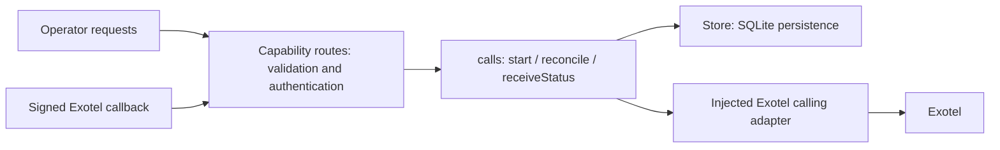

# Codebase redesign

## Requirements and scope

Preserve the documented single-operator, single-process test MVP: static orders, configurable Gemini/Sarvam voice, browser practice, explicit operator-triggered Exotel dialing, transcripts, and reconciliation. Preserve HTTP/WebSocket contracts, settings snapshots, and existing persisted data. No new dependencies or database migration are required.

The documented workload is at most five active or uncertain calls. Admission must persist an attempt before contacting Exotel, replay an idempotency key without redialing, and keep ambiguous provider failures blocked until reconciliation. Transport completion must never imply an order confirmation. Browser outcomes must remain practice-only.

Production call volume, latency targets, customer-contact policies, infrastructure budget, and real order-system requirements are still unspecified. This redesign retains the existing deployment model; it does not claim production campaign readiness.

## Module assessment

| Module                                              | Finding                                                                                          | Decision                                                                                                                                            |
| --------------------------------------------------- | ------------------------------------------------------------------------------------------------ | --------------------------------------------------------------------------------------------------------------------------------------------------- |
| `apps/api/src/app.ts`                               | Startup, security, and route handlers shared one file.                                           | Keep startup and resource ownership here; register capability-specific routes with shared HTTP security.                                            |
| `apps/api/src/modules/voice/voice.ts` and `live.ts` | One voice interface already hides two actual adapters, Gemini and Sarvam.                        | Preserve this seam and the shared outcome validation.                                                                                               |
| `apps/api/src/platform/persistence/store.ts`        | SQLite owns persisted state, single-use claiming, monotonic status updates, and atomic outcomes. | Reuse the concrete module with in-memory SQLite for tests. Add a full-database active-phone query instead of consulting the capped history listing. |
| `apps/api/src/config/index.ts`                      | Configuration is already typed, validated, and centralized.                                      | Pass only the call limit and readiness functions into the calls module.                                                                             |
| `apps/web/src/main.ts`                              | Rendering, requests, navigation, forms, and voice practice shared global state in one file.      | Use a small entry point, an encapsulated workspace coordinator, feature views, a practice controller, and a typed HTTP client.                      |

## Selected seam

Route files group transport concerns by capability, while the calls module owns call rules. A generic repository interface would add a hypothetical seam because SQLite is the only required persistence adapter. The chosen calls module hides the admission and provider-failure implementation behind three operations while reusing persistence and existing calling functions.

`start` accepts a validated order ID, mode, and request key and returns the persisted call. It owns readiness checks, decision checks, active-attempt protection, concurrency admission, settings snapshots, and the one dial attempt. Idempotent replay returns the same call even when admission capacity has subsequently been reached.

`reconcile` accepts a call ID and returns the persisted call after a recognized provider response. Failed lookups and unrecognized responses preserve the current attempt. `receiveStatus` accepts an authenticated call ID, provider call ID, and provider status; it checks identity and delegates monotonic updates to Store. Request validation, callback credentials, and browser token issuance remain transport responsibilities.

The calling adapter reports ambiguous dial failures with `ProviderError.uncertain`. The calls module owns this error contract; Exotel re-exports the same class to preserve existing imports. Dependencies are injected at app construction, so testing the calls interface does not require loading `.env`, starting Fastify, or contacting a provider. The only runtime import in the calls module is the shared contracts package.

Admission remains synchronous through persistence before the first provider await. This preserves the existing one-process concurrency guarantee. Store's unique index remains the final protection against simultaneous active phone attempts for an order. The new active-phone query checks all records, including attempts older than the 200-entry dashboard history.

## Workspace organization

The agreed workspace uses `apps/api`, `apps/web`, and `packages/contracts`. TypeScript remains the implementation language; Fastify, Vite, SQLite, and the provider adapters retain their behavior. Backend-only modules remain under the API rather than becoming individual packages. Contracts are shared by two actual consumers, so their package seam has immediate use.

`workspace:*` imports replace relative imports across projects. Contracts expose compiled ESM and declarations; API builds emit only API source and browser builds use their own DOM configuration. A root TypeScript base retains strictness and `noUncheckedIndexedAccess`. pnpm runs builds in dependency order, with contracts first.

Root `.env` and existing SQLite data remain in place. API runtime paths resolve from the module location and work in both `src` and `dist`, including when the process starts outside the repository root. The web package never imports backend configuration. Root scripts preserve existing build, start, check, test, and provider-check commands and add `dev:all` for all watchers.

## Route and frontend organization

`apps/api/src/app.ts` composes dependencies and plugins, registers routes, serves built assets, and owns cleanup. Operator routes live in `modules/auth/routes.ts`, `modules/workspace/routes.ts`, and `modules/calls/routes.ts`. Exotel callbacks live in `modules/calls/callbacks.routes.ts`; browser and phone WebSocket admission live in `modules/voice/routes.ts`. `platform/http/security.ts` installs shared authentication, origin/host checks, response headers, and safe error handling before route registration. Registration functions use the same Fastify scope so extracting routes cannot bypass these hooks. Media sessions close before SQLite during shutdown.

`apps/web/src/main.ts` only loads styles and starts the workspace. `workspace.ts` owns session state, navigation, refresh/polling, and operator actions inside one instance. Pure HTML views live under `features/auth`, `features/orders`, `features/calls`, `features/settings`, and `features/practice`; shared escaping and transcript formatting live in `ui/format.ts`, with the workspace layout in `ui/shell.ts`. The practice controller owns microphone/session lifecycle and live transcript state; `voice.ts` retains the audio implementation. No frontend framework or dependency is added.

`api/client.ts` centralizes named HTTP operations and session-expiry handling. API and browser share `WorkspaceState`, `StartCallRequest`, `StartCallResponse`, and `CallDetail` through `packages/contracts/src/api.ts`. Existing URLs, signed-token purposes, cookie behavior, and request bodies remain compatible. Failed phone requests retain their request key for a safe retry. Practice cancellation is checked after both microphone preparation and the asynchronous token request so a late response cannot reconnect an ended session.

## API modular monolith

The API groups operator authentication, workspace management, call orchestration, and live voice under `src/modules`. Shared HTTP enforcement, token signing, and transactional SQLite live under `src/platform`; validated configuration and runtime paths live under `src/config`. Exotel belongs to calls infrastructure, while Gemini/Sarvam belong to voice providers. Startup imports module entry points instead of reaching into route files or adapters.

Workspace routes invoke an injected application service for dashboard state, settings persistence, and guarded test-order reset. Calls owns its provider wiring and browser-attempt expiry timer. The calls application entry point remains configuration-free. The source dependency checker rejects infrastructure-to-module imports, imports into another module's internals, and configuration/transport/provider dependencies in application services. See the [API guide](../apps/api/README.md) for the complete tree and rules.

One SQLite Store remains shared to preserve atomic call/order decisions. Splitting it into module-specific databases or adding generic repository wrappers is not needed for the current single-process workload. No dependencies, database migration, service deployment, queue, or language change are introduced.

API `dist` is a generated deployment artifact: development runs `src/index.ts`, while production `start` runs `dist/index.js`. API builds validate first, clean their own output, then compile; this prevents moved source files leaving obsolete executable artifacts. Runtime paths work at the new depth in source and compiled configurations.

## Verification

Focused tests cross the calls interface using real in-memory SQLite and fake calling adapters. They exercise in-flight idempotency and capacity, terminal callbacks arriving before dial responses, conflicting callback/dial identities, failed and unrecognized reconciliation, and active attempts buried behind newer history.

The API dependency checker passes for current source imports. Disposable fixtures verify that it rejects imports into another module’s internals, infrastructure dependencies on modules, and application-service dependencies on configuration. Source and compiled runtime smoke checks also verify settings persistence, rejecting reset during an active call, and preserving call history after reset. API build output contains exactly the current source modules, with no stale paths.

Existing transport tests still verify authentication, origins, callback credentials, and WebSocket token use. They exercise the same calls module through HTTP. No real phone call or billable AI session is needed for these checks.

A route-registration regression test checks authentication on every operator route, origin rejection on every mutation, validation errors, missing-call responses, and logout cookie clearing. Browser verification against a disposable in-memory API covers login, order filtering, call-history navigation, provider field switching, and saving settings. The test server disables outbound requests and uses dummy credentials; the operator's database remains untouched.

Validation: `pnpm check` and `pnpm build` pass. All four focused calls tests pass. The full suite reports 23 passing tests and the two existing provider-request failures below; both failures were reproduced from an isolated copy of the original Git revision.

Workspace installation passes with `pnpm install --offline --frozen-lockfile` using the existing dependency versions. Runtime smoke checks pass for source execution from `apps/api` and compiled execution from `/tmp`, using an in-memory database with external requests disabled. Checks cover health, operator login, dashboard state, compiled frontend assets, CSP, and the microphone worklet. Both runtime configurations preserve relative, absolute, and `:memory:` database paths.

Two existing Exotel request tests fail on the original revision as well: the adapter emits local-format numbers while a test expects E.164, and its flow URL differs from the test expectation. These provider-protocol decisions require a separate review; changing tests solely to match the implementation would not establish compatibility.

## Remaining work

Exotel's existing rejection handler logs and stores the raw upstream error body. Redact it before production because the calls module returns stored errors to the operator. Provider URL and phone-format compatibility should be verified against the account's supported flow before changing the failing tests.

Startup recovery also traverses the capped call-history listing. A future recovery change should query all active attempts directly, as admission now does. Production scheduling, shared persistence, session revocation, transcript retention, and operational alerts remain the requirements already identified in the architecture document.
