# AI voice agent stack: concepts, options and decisions

Working notes for choosing how to build, host and connect an AI calling agent for an Indian client. Started 15 October 2026. Prices and feature claims below are **not verified quotes**; confirm them with each provider before quoting the client.

## 1. How a phone call reaches an AI agent

- **Telephony provider** (Exotel or Plivo): owns the Indian number and connects to Jio, Airtel and the other networks. Streams call audio over the internet (WebSocket or SIP).
- **Voice engine** (our code, Pipecat or LiveKit): converts audio formats, detects speech and handles interruptions.
- **AI models**: ears → brain → mouth (STT → LLM → TTS), or one speech-to-speech model.

Every option in this document fills one of those boxes. Mixing them up (for example, treating a framework as a telephony provider) is the most common source of confusion.

## 2. Corrections to our early assumptions

| What we assumed                                                      | What is actually true                                                                                                                                                                                                                                                                                                                                                                                                                |
| -------------------------------------------------------------------- | ------------------------------------------------------------------------------------------------------------------------------------------------------------------------------------------------------------------------------------------------------------------------------------------------------------------------------------------------------------------------------------------------------------------------------------ |
| "Not using a framework was the first mistake."                       | The current TypeScript code already does what Pipecat's Exotel integration does: resampling, framing, barge-in clearing, playback marks. The silent test call happened because **Exotel never opened a stream** (`ThrottleLimit=0`, see `exotel-streaming-check.md`). A framework would have hit the same wall. A framework is still worth adopting for long-term maintenance, but it is not the bug fix. |
| "Options are LiveKit, Pipecat or raw WebRTC code."                   | WebRTC is a **transport** (how audio moves), not an alternative to a framework. Our app uses **PCM audio over WebSockets**, not WebRTC. The real choice is **custom code vs a framework (Pipecat / LiveKit Agents) vs a managed agent platform**.                                                                                                                                                                                    |
| "Pipecat is in Python."                                              | Correct for the server. Pipecat also has JavaScript **client** SDKs for browsers. **LiveKit Agents** supports both Python and **Node.js/TypeScript**.                                                                                                                                                                                                                                                                                |
| "Some frameworks are on the cloud, some are self-hosted."            | Pipecat and LiveKit are both **open source and self-hostable**. Each company also sells **optional managed hosting** (Pipecat Cloud, LiveKit Cloud). The framework and where it runs are separate choices.                                                                                                                                                                                                                           |
| "Exotel and Sarvam let you build and host agents on their platform." | Two different things. **Sarvam** offers a managed AI agent product (they host the whole agent). **Exotel** mainly connects calls to an agent you run yourself (AgentStream / Voicebot). Confirm with Exotel whether they now sell a fully hosted agent.                                                                                                                                                                              |
| "KYC is a Plivo problem."                                            | KYC is an **Indian telecom rule**. Exotel, Plivo and every provider issuing Indian numbers require it. Since we are building for a client, the **client's business** completes KYC and owns the account.                                                                                                                                                                                                                             |
| "Twilio gives Indian numbers."                                       | Twilio does not offer a standard domestic Indian voice number for this use, and calls cost roughly 13× more than Indian providers in our estimate.                                                                                                                                                                                                                                                                                   |

## 3. Glossary: what each tool is for

| Name                | Category                                    | What it is for                                                                                            |
| ------------------- | ------------------------------------------- | --------------------------------------------------------------------------------------------------------- |
| **Exotel**          | Telephony (India)                           | Indian numbers, KYC, streams call audio to our server (AgentStream / Voicebot applet).                    |
| **Plivo**           | Telephony (global, India supported)         | Indian numbers with business approval; Audio Streams over WebSocket; clean APIs.                          |
| **Twilio**          | Telephony (global)                          | Best docs and ecosystem; not suited to domestic Indian numbers.                                           |
| **Telnyx**          | Telephony (global)                          | Cheaper than Twilio, SIP and streaming; limited India availability.                                       |
| **Pipecat**         | Voice agent framework (Python, open source) | Builds the pipeline: transport → STT → LLM → TTS, with VAD, interruptions and an Exotel/Plivo serializer. |
| **Pipecat Cloud**   | Managed hosting                             | Runs Pipecat agents for you. Optional.                                                                    |
| **LiveKit**         | Real-time media server (open source)        | WebRTC rooms, SIP gateway.                                                                                |
| **LiveKit Agents**  | Voice agent framework (Python, Node.js)     | Agent logic on top of LiveKit; phone calls arrive through SIP.                                            |
| **LiveKit Cloud**   | Managed hosting                             | Hosted LiveKit server and agents; sells US numbers.                                                       |
| **Gemini Live**     | AI model (speech-to-speech)                 | One model listens and speaks; supports Hindi and English.                                                 |
| **OpenAI Realtime** | AI model (speech-to-speech)                 | Same idea as Gemini Live.                                                                                 |
| **Sarvam**          | AI models, Indian languages                 | Saaras (STT), Sarvam-105B (LLM), Bulbul (TTS); also a managed agent product and telephony.                |
| **Deepgram**        | AI models                                   | Fast STT (Nova) and TTS (Aura); also a hosted voice-agent API.                                            |
| **WebSocket**       | Transport                                   | Long-lived two-way connection; how Exotel and Plivo stream call audio.                                    |
| **SIP / SIP trunk** | Transport                                   | Standard protocol for phone calls over the internet; needed for LiveKit phone calls.                      |
| **WebRTC**          | Transport                                   | Browser real-time audio; used by LiveKit and Pipecat browser transports.                                  |
| **VAD**             | Feature                                     | Detects when the caller is speaking.                                                                      |
| **Barge-in**        | Feature                                     | Caller interrupts; agent stops talking.                                                                   |

## 4. Decision: how to build the agent

| Option                                            | Cost                                      | Infra setup                | Quality                                   | Indian ecosystem                                                     | Pros                                            | Cons                                                                           |
| ------------------------------------------------- | ----------------------------------------- | -------------------------- | ----------------------------------------- | -------------------------------------------------------------------- | ----------------------------------------------- | ------------------------------------------------------------------------------ |
| **Custom TypeScript (current)**                   | Lowest; no extra layer                    | One Node process + VPS     | Depends on our own VAD/turn handling      | Works with Exotel directly                                           | Already built, tested, TypeScript               | We maintain every audio and turn-taking detail ourselves                       |
| **Pipecat**                                       | Free (open source); hosting is ours       | Separate Python service    | Mature VAD, interruptions, many providers | Built-in Exotel and Plivo serializers; Sarvam integrations           | Least plumbing for Exotel/Plivo + Gemini/Sarvam | New language for us; another service to deploy                                 |
| **LiveKit Agents**                                | Free (open source); LiveKit server needed | LiveKit server + SIP trunk | Excellent media and turn detection        | Needs SIP from an Indian provider; India numbers not sold by LiveKit | Stays in TypeScript; scales well                | SIP trunk setup and enablement; more infrastructure                            |
| **Managed platform (Sarvam agent, Vapi, Retell)** | Highest per minute; everything included   | None                       | Good, but limited control                 | Sarvam is India-focused                                              | Fastest launch; no maintenance                  | Least control; vendor lock-in; our order-validation logic is harder to enforce |

**Status: proposed, not yet confirmed.** Keep the dashboard and API in TypeScript and move only the live-call voice engine to a **Pipecat** service (`apps/voice`). Revisit LiveKit if we move to SIP at high volume.

## 5. Decision: one model or a combination

| Approach                         | Example                                                               | Cost                                           | Quality                                   | Indian ecosystem                                   | Pros                                              | Cons                                                   |
| -------------------------------- | --------------------------------------------------------------------- | ---------------------------------------------- | ----------------------------------------- | -------------------------------------------------- | ------------------------------------------------- | ------------------------------------------------------ |
| **Speech-to-speech (one model)** | Gemini Live, OpenAI Realtime                                          | Usually per audio token; check current pricing | Most natural, lowest latency              | Hindi/English good; regional accents vary          | Simple pipeline; fast replies                     | Less control over voice and each step; harder to debug |
| **Cascaded (STT → LLM → TTS)**   | Sarvam Saaras → Sarvam-105B → Bulbul; or Deepgram → any LLM → any TTS | Sum of three services                          | Depends on the weakest part; more latency | Sarvam strongest for Indian languages and Hinglish | Swap any part; choose voices; inspect transcripts | Higher latency; more integration work                  |

**Status: keep both,** as the app already does. Gemini Live for natural, fast conversation; Sarvam for Indian-language quality. Choose per client after testing real Hindi/English/Hinglish calls.

## 6. Decision: AI model providers

| Provider     | Role                                 | Indian languages               | Notes                          |
| ------------ | ------------------------------------ | ------------------------------ | ------------------------------ |
| **Gemini**   | Speech-to-speech (Live) and text LLM | Good Hindi/English             | Already integrated             |
| **Sarvam**   | STT, LLM, TTS, managed agent         | Best focus on Indian languages | Already integrated             |
| **Deepgram** | STT, TTS, voice-agent API            | Hindi supported; test Hinglish | Strong latency; not integrated |
| **OpenAI**   | Realtime speech-to-speech, LLMs      | Good Hindi/English             | Not integrated                 |

## 7. Decision: telephony provider

| Provider             | Cost (our estimate, 45k min/month) | Infra setup                             | Quality       | Indian ecosystem                      | Pros                           | Cons                                                                        |
| -------------------- | ---------------------------------- | --------------------------------------- | ------------- | ------------------------------------- | ------------------------------ | --------------------------------------------------------------------------- |
| **Exotel**           | Get a quote                        | WebSocket stream URL or Voicebot applet | Good in India | India-first, numbers + KYC            | Already integrated in our code | Streaming not yet enabled on our trial (`ThrottleLimit=0`); dated dashboard |
| **Plivo**            | ~₹17,300                           | WebSocket Audio Streams                 | Good          | Indian numbers with business approval | Clean APIs, Pipecat support    | Business email and KYC (client's job anyway)                                |
| **Sarvam telephony** | ~₹18,059                           | Unknown for custom stacks               | Unknown       | Indian                                | Same vendor as models          | Unconfirmed whether numbers can stream to our own server                    |
| **Twilio**           | ~₹2,30,912                         | WebSocket Media Streams                 | Excellent     | No standard domestic Indian numbers   | Best docs                      | Far too expensive for Indian calls                                          |
| **Telnyx**           | Not quoted                         | WebSocket or SIP                        | Good          | Limited Indian availability           | Cheap globally                 | Not practical for Indian numbers                                            |

**Status: Exotel now** (already integrated). **Plivo is the backup**, since the client handles KYC either way. Choose by whichever enables streaming first and quotes lower for the client's volume.

## 8. Decision: hosting

| Option                            | Cost                                           | Setup                                            | Pros                    | Cons                              |
| --------------------------------- | ---------------------------------------------- | ------------------------------------------------ | ----------------------- | --------------------------------- |
| **Self-hosted VPS**               | ~₹1,500–4,000/month for ~3–10 concurrent calls | We configure HTTPS/WSS, process manager, backups | Cheapest; full control  | We handle uptime and monitoring   |
| **Pipecat Cloud / LiveKit Cloud** | ~₹43k/month in the shared estimate             | Minimal                                          | Scaling and ops handled | Expensive for 500 calls/day       |
| **Managed agent platform**        | Included in per-minute price                   | None                                             | Zero ops                | Highest total cost, least control |

**Status: self-hosted VPS** close to Indian users (a Mumbai region keeps latency low).

## 9. Cost estimate shared with the client (unverified)

Assumes 500 calls/day × 3 minutes = **45,000 minutes/month**.

| Setup                   | Estimated monthly cost | Includes AI model usage? |
| ----------------------- | ---------------------- | ------------------------ |
| Plivo alone             | ₹17,300                | No                       |
| Sarvam telephony only   | ₹18,059                | No                       |
| Twilio alone            | ₹2,30,912              | No                       |
| Plivo + Pipecat Cloud   | ₹60,041                | **No**                   |
| Plivo + LiveKit Scale   | ₹64,790                | **No**                   |
| Sarvam managed AI agent | ₹1,59,809              | **Yes**                  |

Rows are not comparable until AI usage is added to every self-built option. Missing input: **AI cost per minute** for Gemini Live and for the Sarvam pipeline, from current pricing pages.

## 10. Setup requirements

### For development (us)

- Exotel trial account and test number, with streaming enabled by support.
- Public HTTPS/WSS URL to the local server (Cloudflare tunnel or ngrok).
- Gemini and Sarvam API keys.
- Browser practice mode for testing conversations without phone calls.

### For production (the client)

The client owns every account and pays usage directly.

- **Telephony account** (Exotel or Plivo) in the client's business name.
- **KYC documents** (provider confirms the exact list): company registration or GST certificate, company PAN, address proof, authorised signatory's ID.
- **Streaming enabled** on the account (AgentStream / Voicebot or Audio Streams).
- **An Indian number** purchased on the client's account.
- **Outbound calling compliance:** confirm with the provider whether TRAI rules (DLT registration, DND scrubbing, 140/160-series numbers) apply to order-confirmation calls.
- **AI provider accounts** (Gemini, Sarvam) in the client's name, or billed to them.
- **Credentials shared with us** (API key, token, account SID) or a user login.
- **VPS** in the client's cloud account, with a domain for HTTPS/WSS.
- Contract terms: telephony and AI accounts are client-owned and client-paid.

## 11. Summary of what we are opting for

| Area              | Choice                                 | Status                                          |
| ----------------- | -------------------------------------- | ----------------------------------------------- |
| Dashboard and API | Existing TypeScript app                | Decided                                         |
| Voice engine      | Pipecat service for live calls         | Proposed                                        |
| Model approach    | Both: Gemini Live and Sarvam cascade   | Decided (already built)                         |
| Telephony         | Exotel, Plivo as backup                | Exotel decided; waiting on streaming enablement |
| Account ownership | Client owns accounts and completes KYC | Decided                                         |
| Hosting           | Self-hosted VPS in India               | Proposed                                        |

Diagram sources are the HTML files in [`diagrams/`](diagrams/); the SVGs are exported from them with the diagram-design skill.

## 12. Open questions

- Will Exotel enable streaming on the trial, or only after KYC?
- Can Sarvam's telephony numbers stream to our own server?
- What is the real AI cost per minute for Gemini Live and the Sarvam pipeline?
- Expected peak concurrent calls (not just calls per day)?
- Do the client's order-confirmation calls need DLT registration or a 160-series number?
